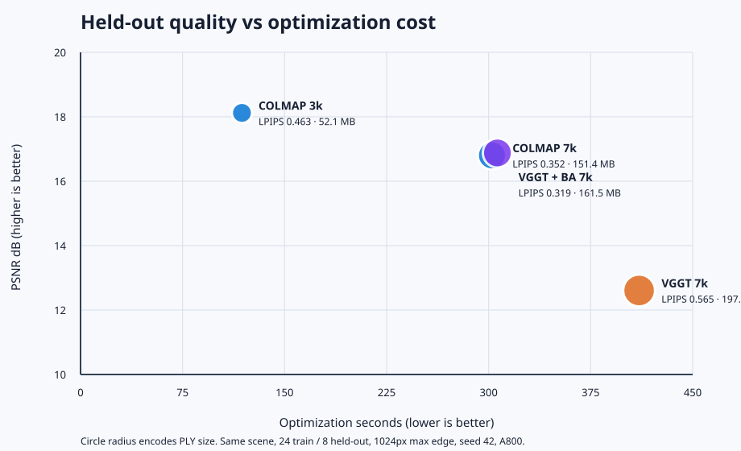

# Robust Sparse 3DGS

An evidence-first workflow for reconstructing static scenes from low-cost sparse captures with COLMAP or VGGT initialization and a pinned gsplat trainer.

The project focuses on a practical failure mode: a pipeline can render attractive training views while sparse-view registration, held-out quality, or resumability is broken. The harness therefore treats failures as results, keeps held-out RGB out of initialization, and records immutable run identities, global GPU budget, artifacts, and hardware.

## What is implemented

- Train-only staging and immutable nested view splits.
- Pinned COLMAP/VGGT adapters and source-contract checks.
- Held-out RGB evaluation after training-camera-only Sim(3) alignment.
- A persistent single-node queue with atomic global GPU-hour reservations, GPU UUID checks, dependency tracking, failure classification, and duplicate-coordinator protection.
- Full-state checkpoints and a strict interrupted-versus-continuous qualification test.
- PLY export, localhost-only viewer integration with calibrated camera presets, and bounded multi-camera render timing.

The initial 200-step runs are integration results, not quality claims. The three-scene 6/12/24-view development matrix, official-BA control and formal render benchmarks are recorded in the [development report](reports/mipnerf360_development_v1.md). The independently frozen three-scene confirmation is in the [final report](reports/mipnerf360_final_v1.md). Earlier first-scene evidence remains in [the bootstrap report](reports/formal_stage_v1.md).

## Quick checks

```bash
python -m unittest discover -s tests -v
python -m bgs --help
python -m bgs.queue --help
```

Deployment intentionally remains explicit because CUDA, COLMAP, gsplat and VGGT need separate pinned environments. See [reproduction](docs/reproduction.md) and the sanitized [config example](configs/run.example.json).

## Evidence status

- Engineering path: validated on A800 GPUs from immutable staging through initialization, training, genuine held-out renders, metrics, PLY and a localhost viewer. A browser/WebGL test verified a recognizable calibrated default view and a changed render after orbit drag; the viewer was then stopped.
- Multi-scene development baseline: three frozen scenes, nested 6/12/24 training views and fixed 24–39-image holdouts. Full-coverage COLMAP initialization succeeded in 1/9 arms; VGGT without BA succeeded in 4/9. All 13 failures remain in the 18-run denominator.
- Official-BA diagnosis: at 24 views, upstream VGGT BA produced full-coverage models on all three development scenes and improved all held-out metrics over no-BA on bonsai and room. On garden it converted a no-BA failure and improved LPIPS versus COLMAP, but reduced PSNR/SSIM and increased model size. This is a reliability result with scene-dependent quality/cost, not a universal winner or a new algorithm.
- Frozen final confirmation: official BA completed counter, kitchen and bicycle at 24/24 coverage, while the paired COLMAP arms registered 20/24, 21/24 and 4/24 and all failed the predeclared coverage gate. The BA held-out endpoints were 19.800/0.6141/0.2639, 18.199/0.4275/0.2365 and 16.935/0.2381/0.4687 respectively. Failed COLMAP arms have no quality score and remain in the denominator.
- Efficiency control: a separately scheduled COLMAP 3k run improved PSNR/SSIM to 18.120/0.4791 and cut optimization time 60.8% and PLY size 65.6%, but LPIPS worsened to 0.4633. Its formal 8-camera render benchmark reduced mean latency 20.7%, increased FPS 26.1% and reduced peak allocated memory 62.2% versus 7k. It is reported as a tradeoff, not a universal quality gain.
- Performance: formal all-heldout-camera timing covers eight development checkpoints. Mean render latency ranged from 1.488 ms for the 297,925-Gaussian room-6 model to 3.151 ms for the 1,542,709-Gaussian garden-BA model; browser/network overhead is excluded.
- Resume: a 20-step no-densification check passed, but shape-changing resume did not reproduce the continuous trajectory. Production resume is therefore not claimed.
- Viewer and delivery: a real WebGL browser loaded a 546,566-Gaussian room model, displayed a calibrated preset and changed the rendered canvas after an orbit drag. A separate 39.97-second private video shows reference/prediction/error panels for bonsai, room and garden and explicitly identifies them as held-out evaluation rather than a novel-view trajectory.
- VGGT licensing: the original VGGT-1B research checkpoint is non-commercial and is never included here. Potential pretraining overlap with these benchmark scenes is not ruled out.



See [limitations](docs/failure_analysis.md), [demo validation](docs/demo.md), [contributions](docs/contributions.md), and [third-party notices](THIRD_PARTY_NOTICES.md).
