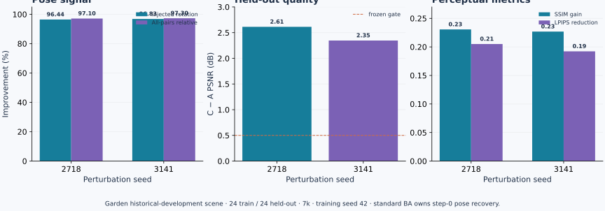
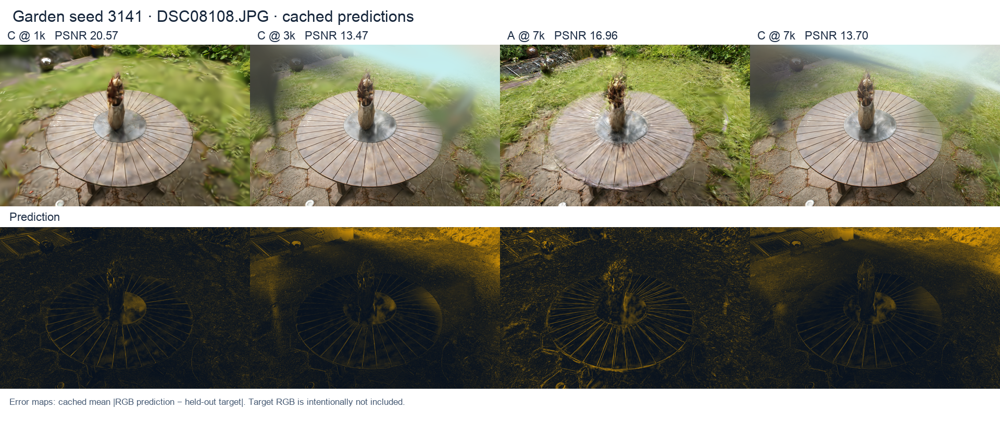

# Robust Sparse 3DGS：从相机误差失效到旋转移植确认

**问题 → 对照 → 反例 → 针对性修复 → 跨场景确认。**

[首页](../README.md) · [复现](reproduction.md) · [技术细节](technical_notes.md) · [结果账本](../reports/README.md)

## 1. 问题：小相机误差会被高斯优化可靠吸收吗？

在固定初始点、内参、RGB、对齐和留出相机后，只给训练相机加入预注册的 1° 旋转误差。Bonsai / Room 的 7k 留出 PSNR 分别下降 0.910 / 3.198 dB，说明问题真实存在且场景敏感。

v3 随后允许光度 pose optimizer 与高斯共同训练，但姿态回收不足，`repair_accepted=false` 保持不变。关闭的所谓“增密”实际同时关闭 clone、split、prune、opacity reset 和结构状态累计，因此只能解释为整个结构策略组合，不能归因某个操作。v4 检查了相机索引、c2w/w2c、旋转乘法、单次修正、梯度和有限差分，没有发现一般性的索引或参数化错误；联合训练后的地图却会改变局部光度目标方向。v5 的“先姿态、再高斯、最后结构策略”3000-step pilot 在两场景都没有改善相对姿态轨迹，且 LPIPS 退化，所以没有被追认为修复。

## 2. 几何强基线：标准 BA 能提供信号，但不自动兑现为重建收益

v6 完全脱离已训练高斯地图，只使用同一批训练图像的二维 tracks、固定内参和标准 COLMAP/Ceres BA。完整 track 身份先做 fit/check 切分；参考姿态只由独立评价读取。Bonsai / Room 的注入旋转回收率为 73.67% / 89.52%，全对相对旋转误差改善 79.75% / 86.69%；打乱对应的负控制没有相同收益。

这一步属于标准 BA，不是新算法。它证明 train-only 对应关系含有可用几何信号，但不证明 GS 留出质量会提高，也不等于真实绝对相机位姿精度。

更早的 matched BA 结果也必须分开理解：它在同一次上游重建里比较 BA 前后快照，**相机和三维点同时改变**，四组配对 PSNR 提升 1.591–2.166 dB。它支持联合 BA 操作有效，却不能回答“只把 BA 相机接入同一个 Gaussian 初始化”是否有效。

## 3. 关键反例：完整 BA 相机移植在 Room 失败

v7 固定相机并比较：

- A：原扰动相机；
- B：标准 BA 输出的完整相机，包括旋转和中心更新。

两臂从相同正常 Gaussian 初始化开始，不导入 BA 新三维点，不重新归一化，不做 pose optimization。Bonsai 的 B−A PSNR 为 +1.055 dB，但 Room 为 −0.067 dB，低于预注册的 +0.50 dB 门槛；`v7 FAIL` 保留。这个反例说明“姿态指标改善”本身不能作为工程验收。

诊断显示，本轮只注入旋转，BA 却让 Bonsai / Room 相机中心平均移动名义半径的 4.29% / 3.10%。把这种中心变化接到原 Gaussian 初始化上，破坏了原有坐标一致性的可能性因此成为单一修复假设。

## 4. 针对性修复：只移植旋转，保留输入中心

v8 的 C 臂严格定义为：左上 3×3 使用标准 BA 的 OpenCV c2w 旋转，右上 3×1 保留 A 的世界坐标相机中心。不是保留 w2c 的 `tvec`，没有插值、重新 BA、重新归一化或替换 BA 点。

CPU 固定原始点—track 对应检查显示，B→C 的重投影 median/P95 从 86.60/156.59 降到 14.06/24.11 px（Bonsai），从 56.19/135.54 降到 2.17/8.08 px（Room）。共同 7k 终点上，C−A PSNR 为 +1.233 / +3.645 dB；两场景通过未改动的 v7 门槛，记为 `v8 development PASS`，但不追改 v7。

## 5. Garden 两扰动确认

Garden 是历史开发场景，而不是从未使用的全新外部测试集。它在 v7 阶段预先选定，用于 Bonsai / Room 机制设计之外的跨场景确认。训练图 24 张、留出图 24 张，扰动 seeds 为 2718 / 3141，训练 seed 均为 42，共同终点 7k；纯旋转 1°、零平移、camera 0 不扰动。

| 扰动 seed | 注入旋转回收 | 全对相对旋转改善 | C−A PSNR | C−A SSIM | C−A LPIPS | 判定 |
|---:|---:|---:|---:|---:|---:|:---:|
| 2718 | 96.436% | 97.098% | +2.612597 dB | +0.230562 | −0.205059 | PASS |
| 3141 | 96.829% | 97.295% | +2.346550 dB | +0.226828 | −0.192249 | PASS |

每个 seed 都同时通过姿态、PSNR、SSIM、LPIPS、技术合同和完整分母门槛，因此最终结论为 **`CROSS_SCENE_CONFIRMATION_PASS`**。全部 step-0 姿态收益仍归属于标准 BA；新增证据仅是“旋转移植＋保留输入中心”在固定相机 GS 中的跨场景、跨扰动兑现能力。

## 6. 保留反例：DSC08108 不是“所有图都全指标改善”

seed 2718 的 PSNR 改善 24/24；seed 3141 为 23/24。两组 SSIM、LPIPS 都是 24/24 改善。唯一 PSNR 反例 `DSC08108.JPG` 在 seed 3141 上从 A 的 16.9589 dB 降到 C 的 13.7016 dB（−3.2573 dB），但 SSIM +0.2363、LPIPS −0.0692。

CPU 事后检查核对了 1k/3k/7k 各自保存的 GT/预测三联 PNG、图像身份、RGB、1024×664 尺寸和误差构造。C−A PSNR 在 1k 为 +2.127 dB，到 3k 变成 −4.168 dB，7k 为 −3.257 dB；最终 C 的 92.2% 平方 RGB 误差集中在图像上半部，平均亮度偏差 +0.0283，蓝通道偏差 +0.0956。全通道近白饱和仅 0.0046%，不支持“大范围 clipping”解释。

这些缓存支持“3k 前出现了局部上方亮度/颜色伪影”，但没有逐 Gaussian 可见性、opacity 或结构事件到局部像素的因果收据。结构策略当时处于活动期只是时间上的相容性，**不能直接归因增密**。PNG 量化重算仅作诊断；原始浮点 PSNR/SSIM/LPIPS 仍是权威指标，没有回选 checkpoint 或重调 v9。

## 7. 成本、交付和边界

v9 共计 5.692589 / 6.12 GPUh；campaign 共计 15.390247 / 16 GPUh，剩余 0.609753 GPUh。本次成果整理使用 0 GPUh。原始 2718/C OOM、retry01 PID namespace 监控失败、首次 watchdog 跳过测试及 CPU 合同失败都保留并计费；最终四个有效 7k endpoint 完整。

公开仓库保留精简机器结果、协议、实际任务配置、运行器、CPU 诊断代码及生成图。原始 RGB、权重、checkpoint、PLY、现场进程日志和大模型资产不提交。`final_v1` 仍封存；v3 `repair_accepted=false`、v7 `FAIL`、v8 `development PASS` 均不改写。

仍未解决：混合旋转/平移扰动下是否仍应固定中心；Garden 不是全新外部测试；`DSC08108` 局部伪影的具体高斯/结构因果；真实绝对位姿精度；以及跨 densification 的生产级 resume 资格。
