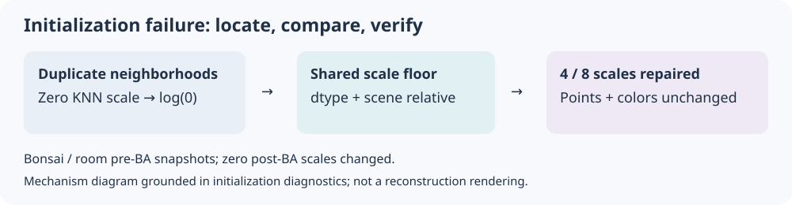
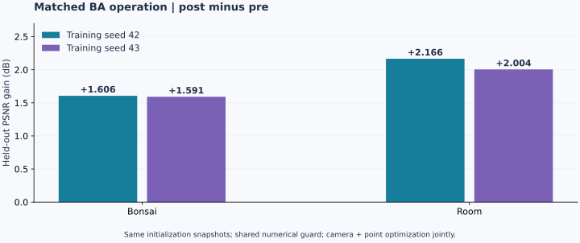
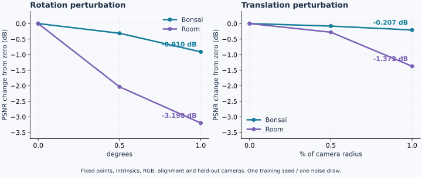

# Robust Sparse 3DGS：稀疏视角重建与失效诊断

**从“能运行”推进到“知道为什么失败、收益来自哪里”。**

面向少量照片的静态场景重建，我搭建 COLMAP / VGGT 与 gsplat 的训练、留出评估及 PLY / WebGL 交付流程。项目的研究重点是：**初始化失效定位、配对 BA 验证、位姿误差的受控分析**。

[返回首页](../README.md) · [完整实验索引](../reports/experiment_index.md) · [个人贡献与上游归属](contributions.md)

## 01｜失效定位：从训练异常追到初始化

**问题。** 历史记录把失败记在 step 100，容易误以为训练过程崩溃。逐阶段回放发现，在第一次 forward 之前，重复点簇已经使近邻距离均值为零，导致初始尺度取对数后出现负无穷。

**设计选择。** 比较“去重”和“正尺度下界”两种修复。去重会改变点数与颜色，因此采用与 dtype、场景尺度相适应的下界，并对 pre / post BA 两臂使用相同规则。

**验证。** bonsai / room 仅修正 4 / 8 个退化点的尺度，点数、颜色和覆盖保持不变；post-BA 两臂无需触发下界。四臂通过逐步有限值检查，seed 42 的四个 7k 训练全部完成。

**体现的能力：失效阶段定位、数值稳定性分析、修复方案取舍。** 这是常规数值稳健性修复，不包装成新的重建算法。

证据：[初始化诊断](../reports/diagnostics/splat_initialization_nonfinite_v1.json) · [实现](../bgs/splat_numerics.py)。

## 02｜配对验证：BA 收益到底能说明什么

**控制。** 在同一次上游重建中保存 BA 前后不可变快照，使用相同尺度修复和下游训练配置；两场景各重复两个训练 seed。

**结果。** 四个配对的 PSNR 提升 1.591–2.166 dB，SSIM 和 LPIPS 均改善。结果支持这两组快照上的 **camera + point 联合 BA 操作收益**。

**体现的能力：设计匹配对照、隔离分支差异、约束实验归因。** 完整 VGGT `use_ba` 分支还改变跟踪与点构造，不能直接把分支对比等同于单因素 BA；两个 seed 复用同一初始化，也不能当作独立初始化重复。

证据：[两 seed 汇总](../reports/ba_operation_ablation_floor_seed_aggregate_v1.json) · [seed 42 明细](../reports/ba_operation_ablation_floor_s42_v1/results.md) · [seed 43 明细](../reports/ba_operation_ablation_floor_s43_v3/results.md)。

## 03｜几何分析：固定点云，只改变训练位姿

**控制。** 固定初始点、内参、RGB、对齐和留出相机；只向训练位姿加入预注册的旋转或平移扰动。平移按相机半径归一化，各强度共享噪声方向。

**结果。** 1° 旋转使 bonsai / room 的 PSNR 分别下降 0.910 / 3.198 dB；1% 半径的平移分别下降 0.207 / 1.372 dB。这组实验中 room 对旋转更敏感。

**体现的能力：几何变量控制、敏感性分析、结果边界判断。** 两场景、一个训练 seed 和一个噪声方向集合，不能推出普遍鲁棒性；也没有三维真值来支持几何精度结论。

证据：[协议](../protocols/pose_sensitivity_v1.json) · [分析与资源开销](../reports/pose_sensitivity_v1/analysis.md) · [原始结果](../reports/pose_sensitivity_v1/results.json)。

## 工程交付与可视化

| 环节 | 已实现的内容 |
|---|---|
| 输入与初始化 | train-only 数据隔离、不可变 split / hash、COLMAP / VGGT 接入 |
| 训练与调度 | pinned gsplat 适配、共享 GPUh 预算、失败记录与任务快照 |
| 评估与输出 | calibrated held-out PSNR / SSIM / LPIPS、PLY 导出、GPU 渲染基准 |
| 交互检查 | 真实本地 WebGL 模型加载、校准相机预设和 orbit 操作验证 |

South Building 单场景的 3k / 7k 对照降低训练时间 **60.8%**、PLY 大小 **65.6%**，但 LPIPS 从 0.3516 变为 0.4633：这是质量与成本取舍。

真实 reference / prediction / error 视频已私下验证，公开仓库暂不包含这些 benchmark 派生图像。当前图表展示真实数值；效果图与视频的说明见 [demo 记录](demo.md)。

## 深入阅读

- **复现：** [运行与环境](reproduction.md)、[实验协议](protocol.md)。
- **研究深挖：** [贡献边界](contributions.md)、[失效分析](failure_analysis.md)。
- **完整记录：** [实验索引](../reports/experiment_index.md)、[历史证据摘要](evidence_status.md)、[工程交付说明](industrial_delivery_zh.md)。

当前仍未通过跨 densification 的生产级 resume 验收。上游模型、BA、rasterizer 与训练策略均明确归属；本项目不主张 SOTA。VGGT 权重的许可与潜在预训练重叠见 [第三方说明](../THIRD_PARTY_NOTICES.md)。
